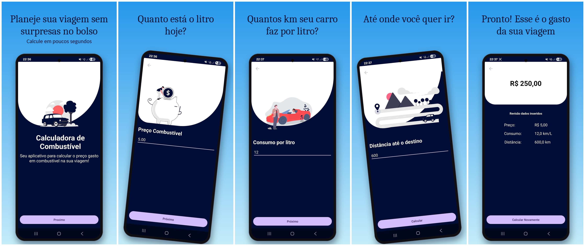

# ⛽ 10D Challenge | Escola Nova Era Tech | Calculadora de Combustível/Fuel Calculator

Fiz este projeto com o auxílio do professor Roque, da Escola Nova Era Tech. Ele consiste em um aplicativo Android, desenvolvido em Kotlin, que calcula quanto você vai gastar de combustível em uma viagem a partir do preço do litro, do consumo do veículo e da distância percorrida.

## 🧩 Tecnologias e conceitos utilizados

Este projeto utiliza **fundamentos do Android tradicional**:

- Kotlin
- Android
- Activities
- UI com XML (com ConstraintLayout)
  - TextView
  - EditText
  - Button
- Toolbar (`MaterialToolbar`)
- Navegação entre telas com Intent
- Passagem de dados entre telas com Bundle
- Organização básica de layouts e telas
- Gradle com Kotlin DSL

## 📱 Como funciona

O app guia o usuário por um fluxo simples de telas:

1. **Início**: apresentação do app e botão para começar.
2. **Preço do combustível**: valor do litro (ex.: 5,89).
3. **Consumo do veículo**: quantos quilômetros o carro faz por litro (km/l).
4. **Distância da viagem**: quantos quilômetros serão percorridos.
5. **Resultado**: custo total da viagem e um resumo dos dados informados, com opção de fazer um novo cálculo.

### Cálculo

```
litros necessários = distância ÷ consumo
custo total        = litros necessários × preço por litro
```

**Exemplo:** 600 km, consumo de 12 km/l e gasolina a R$ 5,00 o litro

- Litros necessários: 600 ÷ 12 = 50 L
- Custo total: 50 × 5,00 = **R$ 250,00**

## 📸 Prints do aplicativo



## 📚 Sobre o projeto

A ideia do app é resolver um problema do dia a dia: saber, antes de pegar a estrada, quanto vai custar o combustível da viagem. Por ser um projeto de aprendizado, o foco foi manter tudo simples e fácil de entender, construindo o app passo a passo.

## 🏁 Resultado final

Ao concluir o **10D Challenge**, eu saio com bem mais do que um app funcionando. Este foi o meu primeiro contato real com o desenvolvimento Android, e o que eu levo dele é:

- ✅ Um aplicativo Android funcional, que eu construí em Kotlin
- ✅ Aprendi a criar telas com XML e a navegar entre elas usando `Intent`
- ✅ Entendi como passar dados de uma tela para outra
- ✅ Pratiquei lógica de programação ao montar o cálculo do custo da viagem
- ✅ Publiquei o meu primeiro projeto no GitHub e aprendi a documentá-lo com um README
- ✅ Mais confiança para continuar estudando e criar projetos maiores

Este projeto representa o início da minha jornada no ecossistema Android dentro da **Escola Nova Era Tech**, e eu quero continuar evoluindo como desenvolvedor 🚀

## 📄 Licença

Este projeto está sob a licença **MIT**. Consulte o arquivo LICENSE para mais detalhes.

## 🤝 Contribuições

Contribuições são bem-vindas! Este é um projeto de aprendizado e fico feliz em receber sugestões, correções e melhorias.

## 👤 Autor

Feito por **Matheus Gomes**, desenvolvedor mobile (Android | Kotlin).

- GitHub: [@inojosaaDev](https://github.com/inojosaaDev)
- LinkedIn: [in/matheus-inojosa](https://www.linkedin.com/in/matheus-inojosa/)
